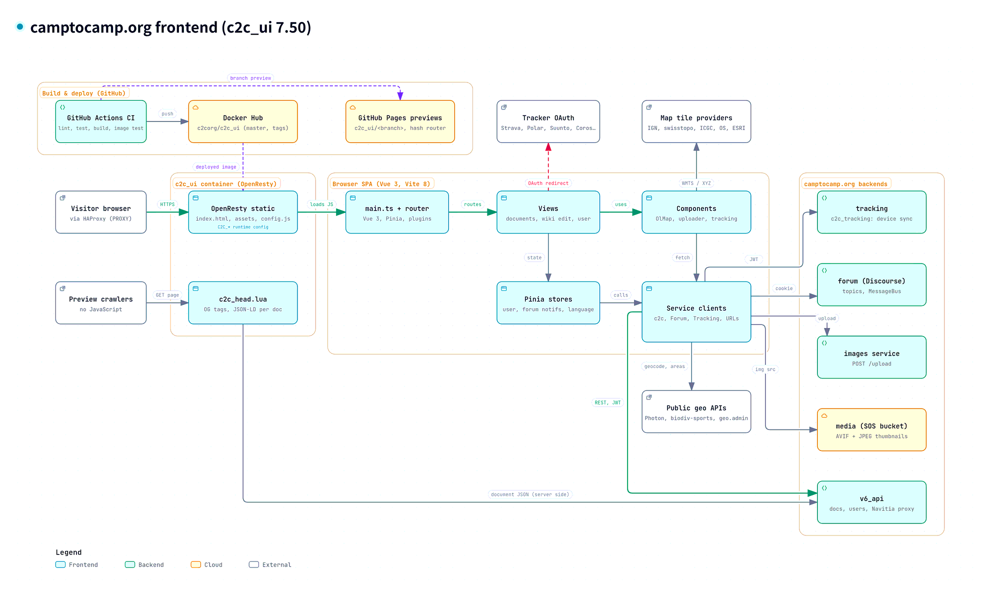
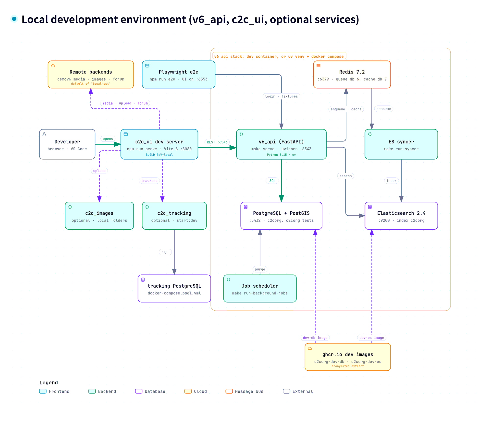

# [camptocamp.org](https://www.camptocamp.org)

[](https://github.com/c2corg/c2c_ui/blob/master/LICENSE)   [](https://www.codacy.com/gh/c2corg/c2c_ui/dashboard?utm_source=github.com&utm_medium=referral&utm_content=c2corg/c2c_ui&utm_campaign=Badge_Grade)

## Architecture

This is the Vue3-based responsive web frontend of camptocamp.

*(Click for the interactive version)*

#### Frontend (c2c_ui)

[](https://c2corg.github.io/v6_api/architecture/frontend.html)

#### Local development

[](https://c2corg.github.io/v6_api/architecture/local-dev.html)

## Setup

On any OS, install [git](https://git-scm.com/) and [node.js](https://nodejs.org/en/) (the current LTS, as in CI; some
development dependencies need at least 22.22.2 or 24.15, e.g. `nvm install --lts`). Then :

```bash
# Download camptocamp.org source code :
git clone https://github.com/c2corg/c2c_ui
cd c2c_ui

# Install dependencies. It's quite long, but you have to do it once.
npm ci
```

And now, let's launch

```bash
npm run serve
```

:heart: [http://localhost:8080](http://localhost:8080) :heart:

⚠️ The dev server starts on the **production** backend. To use a local API ([v6_api](https://github.com/c2corg/v6_api),
on `http://localhost:6543`, whose dev configuration allows this origin), choose `localhost` in the backend selector of
the navigation bar: the choice is kept in the browser (local storage).

Other tasks: `npm run lint`, `npm test` (unit tests), `npm run e2e` (Playwright), `npm run type-check`,
`npm run build`. See also [the wiki](https://github.com/c2corg/c2c_ui/wiki/Development-environment).

## Backend urls

The backend (API, media, images...) is chosen when the app **starts**, not when it is built, so the same Docker image
can serve any backend. Variables that are not set keep the production urls.

| Variable                 | Meaning                                                                                |
| ------------------------ | -------------------------------------------------------------------------------------- |
| `C2C_BACKEND`            | A backend known to the build (`prod`, `demo`)                                          |
| `C2C_API_URL`            | API, e.g. `https://api.example.org`                                                    |
| `C2C_MEDIA_URL`          | Media (images) storage                                                                 |
| `C2C_IMAGE_BACKEND_URL`  | Image upload backend                                                                   |
| `C2C_TRACKING_URL`       | Tracking service                                                                       |
| `C2C_MINIATURES_URL`     | Tracking miniatures storage                                                            |
| `C2C_FORUM_URL`          | Forum                                                                                  |
| `C2C_RECAPTCHA_KEY`      | Public reCAPTCHA key of the domain serving the app                                     |
| `C2C_ENV_LABEL`          | Non-production environment name (`preprod`): shows a banner and prefixes the tab title |
| `TRACKS_OVERLAY_ENABLED` | `false`, `0`, `no` or `off`: the Outings and Routes map overlays are not offered       |

The API reads `TRACKS_OVERLAY_ENABLED` too (it answers 503 when it is off): set it on both to relieve the servers.

With Docker (`LISTEN_FLAGS=` because, by default, the container expects the PROXY protocol of the production load
balancer; `PORT` is the port nginx listens on):

```bash
docker run --rm -p 8081:80 -e LISTEN_FLAGS= -e C2C_API_URL=http://localhost:6543 c2corg/c2c_ui
```

`npm run serve` reads the same `C2C_*_URL` variables for its `localhost` backend only (e.g. an API on another port: `C2C_API_URL=http://localhost:6544 npm run serve`; `C2C_BACKEND` is ignored there),
which you pick in the backend selector of the navigation bar. How it works: `docker/runtime-config.sh` writes `/config.js` when
the container starts, `src/js/runtime-config.ts` applies it on top of the build configuration (`vite.config.ts`).

## Previews de PR

Chaque PR (hors PR venant d'un fork) build le front et le publie automatiquement
sur `gh-pages`, à l'URL `https://c2corg.github.io/c2c_ui/<nom-de-branche>/`
(cf. `.github/workflows/ci.yml`, job `github-pages`). Depuis que ce job tourne
dans l'environnement GitHub `pr-preview` pour les événements `pull_request`,
il attend l'approbation d'un reviewer avant de déployer quoi que ce soit —
n'importe qui ne peut plus déclencher une publication publique juste en
poussant sur une branche.

**Configuration à faire une seule fois** (repo Settings, accès admin requis —
pas quelque chose qu'un commit peut faire) :

1. Settings → Environments → New environment → nommer `pr-preview`.
2. "Required reviewers" → ajouter les mainteneurs habilités à approuver une
   preview (l'équipe qui merge d'habitude sur ce repo).
3. Ne rien configurer sur l'environnement `github-pages-deploy` (utilisé pour
   les push sur `master`/tags, donc du code déjà relu au moment du merge —
   pas de friction supplémentaire à ajouter là).

Sans cette étape, GitHub crée l'environnement `pr-preview` sans aucune règle
de protection au premier run et le déploiement continue de partir sans
approbation — la protection ne prend effet qu'une fois la règle posée dans
Settings.
